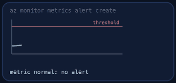
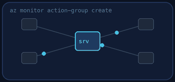
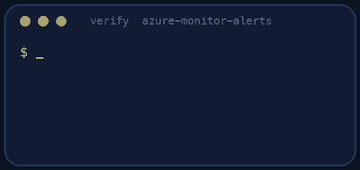
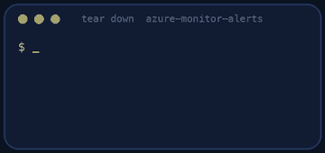

<p align="center"></p>

| | |
|-|-|
| **Time** | 75-90 min |
| **Cost** | free (a storage account and two alert rules cost cents) |
| **You need** | An Azure subscription where you can create resources, the Azure CLI (`az login` done), Python 3 and a terminal |

## How this lab works

1. **Fork** this repository to your own GitHub account (button at the top right).
2. Clone **your fork** in your Ubuntu environment (WSL on Windows, your OrbStack machine on Mac).
3. Read the lab below (the same text is in [`LAB.md`](LAB.md)) and follow the mission.
4. Answer the questions in [`SUBMISSION.md`](SUBMISSION.md). Where a question asks for output, paste it in a code block. No screenshots needed.
5. Commit and push. Open the **Actions** tab of your fork (click *I understand my workflows, go ahead and enable them* the first time). The **Lab check** shows what is still missing.
6. When the check is green, **submit the URL of your fork** in the course platform.

> [!NOTE]
> The check only looks at your answers and any files the lab asks you to commit. Your instructor reads your work and may ask you to explain any line.

<p align="center"></p>

## 🎬 The situation

<p align="center"></p>

```text
RUNBOOK RB-17   Alerting on the receipts store
Owner      : on-call engineer (you, from today)
Trigger    : the regulator's review of Beanie, next week
Question   : "Show me that someone is paged when the receipts are attacked or deleted."
Evidence   : two alerts that fired, one action group that delivered them
```

Beanie's receipts live in one Azure storage account. Two failures are silent today: a bot hammers the account (a bill, then an outage), or somebody deletes it (a disaster with a name attached). Azure records them in two places: **metrics** (numbers, every minute) and the **activity log** (who did what to which resource). Both alerts must reach a human through one door: an **action group**.

This runbook is written to be followed at 3 a.m. Each step has an action and a check. Do the check before the next step.

> [!IMPORTANT]
> **Your mission**
> - Create one action group, `ag-beanie-oncall`, with an e-mail and a webhook receiver
> - Create a **metric alert** on the storage account's `Transactions` that fires on a traffic spike
> - Create an **activity log alert** that fires when a storage account is deleted
> - Let the checker attack your storage account and prove that both alerts fire
> - Tear down and prove it

**Time:** 75-90 min | **Cost:** a few cents (one storage account, alert rules) | **You need:** an Azure subscription, the Azure CLI, Python 3 and a terminal.

> [!NOTE]
> **If Azure answers `QuotaExceeded` or `SkuNotAvailable`, do not worry.** It is normal when Azure is in high demand, and it happens to everyone, including professionals. Run `az vm list-usage --location <region> -o table` to see your limits. To ask for more, open the portal: **Quotas > Compute > Request adjustment**, or open a support request. Often a different region or size works at once. This lab only needs a storage account, so you will rarely meet it here, but you will in the other Azure labs: get used to asking.

<p align="center"></p>

## Step 0 - Prepare the target

**Action.** Fork this repository, clone your fork and run:

```bash
az login
./setup.sh
```

**Check.** The resource group `rg-monitor-alerts` exists with a storage account whose name starts with `stmon`, and a container `receipts`. In the portal: **Storage account > Monitoring > Metrics**, metric `Transactions`, aggregation `Sum`.

> [!NOTE]
> **Predict** Nobody uses the account. What does the graph show? What will it show when 300 requests arrive in one minute?

<p align="center"></p>

## Step 1 - Create the action group

<p align="center"></p>

An alert rule sends nothing by itself. It points to an **action group**: a reusable list of receivers.

**Action.** Create **`ag-beanie-oncall`** in `rg-monitor-alerts` with:

- an **e-mail** receiver (any address; it is not confirmed in this lab);
- a **webhook** receiver (any HTTPS URL, for example a chat tool's incoming webhook);
- a **short name** of 12 characters at most (it appears in SMS and e-mails).

```bash
az monitor action-group create --help
```

**Check.** `az monitor action-group show` lists both receivers.

> [!NOTE]
> **Think** Why one action group for many alert rules, instead of e-mail addresses inside each rule? What happens on the day the on-call person changes?

<p align="center"></p>

## Step 2 - Create the metric alert

**Action.** Create **`alert-storage-transactions`** on your storage account:

- metric **`Transactions`**, aggregation **Total**, operator **greater than**, a threshold you choose (between 20 and 500) that normal traffic never reaches;
- **window 5 minutes, evaluated every 1 minute**;
- severity 0, 1 or 2 (0 is the most urgent: what deserves a 3 a.m. call?);
- it triggers your action group.

```bash
az monitor metrics alert create --help
```

**Check.** `az monitor metrics alert show` returns the scope, the criteria and your action group.

> [!NOTE]
> **Think** With a 5-minute window evaluated every minute, how long after a spike starts can the alert fire at best? What does a 1-minute window gain, and what does it cost in false alarms?

<p align="center"></p>

## Step 3 - Create the activity log alert

Metrics tell you about traffic. The activity log tells you **who deleted something**.

**Action.** Create **`alert-storage-deleted`**:

- scope: your resource group (or the subscription);
- condition: category **Administrative** and operation **`Microsoft.Storage/storageAccounts/delete`**;
- it triggers the same action group.

```bash
az monitor activity-log alert create --help
```

**Check.** `az monitor activity-log alert show` returns both conditions and the action group.

> [!NOTE]
> **Think** This alert has no threshold and no window. Why? And what would be the cost of making it too broad, for example every "write" operation?

<p align="center"></p>

## Step 4 - Prove it

<p align="center"></p>


**Action.**

```bash
./verify.sh
```

The script reads the configuration of your three resources, then attacks: it sends 300 read requests to your storage account, creates and deletes a throwaway storage account, and waits for Azure to report both alerts as **Fired**. It takes 10 to 15 minutes. Metrics arrive one to three minutes late. That delay is expected.

**Check.** The output ends with **ALL CHECKS PASSED**. Paste it into `SUBMISSION.md` **before** you tear down. Then open **Monitor > Alerts** in the portal and look at the two fired alerts.

**If it fails.**

| Symptom | Cause |
|---------|-------|
| The metric alert never fires | The scope is not the storage account itself, the threshold is not below 300, or the aggregation is `Average` and not `Total` |
| The activity log alert never fires | The operation name differs from the one above, or the scope does not include the resource group |
| Action group checks fail | A receiver of type e-mail **and** one of type webhook are both needed |

<p align="center"></p>

## Level up (optional)

- Add an alert on **availability** or on `Ingress` bytes, with a dynamic threshold. When is a dynamic threshold better than a fixed one?
- Add an **alert processing rule** that mutes the alerts during a maintenance window. Why not delete the alert instead?
- Add an alert on a **log query** (needs a Log Analytics workspace). What can it express that a metric cannot?

<!-- teardown:start (generated by labs.py, do not edit) -->
## Tear down (mandatory)

<p align="center"></p>

Resources left behind cost money, keep doors open and pollute the next lab. Removing what you created is part of the job, so it is part of the submission: **you must prove it is gone**.

Do this **last**, after you have pasted your `verify` output into `SUBMISSION.md` (once you tear down, the lab can no longer be verified).

1. Run `./teardown.sh`. It deletes the resource group `rg-monitor-alerts` with the storage account, the action group and both alert rules.

Then run the proof:

```bash
./verify-teardown.sh
```

It prints a list of checks and must end with **TEARDOWN VERIFIED**. If it reports leftovers, remove them and run it again. Paste the full output in your submission.
<!-- teardown:end -->

<!-- submission:start (generated by labs.py, do not edit) -->
## 📬 Submission

Answer the questions in `SUBMISSION.md` in **your fork** (paste output in code blocks where asked), push, then submit the **URL of your fork**.

**Files to commit**

- `notes.md` with your commands (optional)

**Questions to answer**

1. Paste your action group (name, receivers). Why is an action group a separate resource from an alert rule, and what is the benefit of one group used by many rules? What are the other kinds of receiver besides e-mail and webhook?
2. Paste your metric alert (scope, metric, aggregation, window, frequency, threshold, severity). Explain window size and evaluation frequency in your own words. What is the difference between a static and a dynamic threshold?
3. Paste the activity log alert. What is the difference between a metric alert and an activity log alert (what each one watches, and how fast each reacts)? Why is "someone deleted the storage account" an activity log event and not a metric?
4. Paste the fired alert (from the Alerts blade or the REST call): its state, severity, the time the traffic started and the time the alert fired. What explains the delay? What does the monitor condition `Fired`/`Resolved` differ from the alert state `New`/`Acknowledged`/`Closed`?
5. Alert fatigue: your rule fires on `Transactions > 50`. Is that a good rule for a production storage account? Name two changes (a dynamic threshold, a different metric, a longer window, severity, a suppression window) that make an alert worth waking someone for.
6. Who receives the notification when your alert fires, and what do they need to find in it to act without opening a laptop? What is missing from a default e-mail?
7. Paste the output of `./verify.sh`. It must end with **ALL CHECKS PASSED**.
8. **Tear down.** Paste the output of `./verify-teardown.sh`. It must end with **TEARDOWN VERIFIED**.
<!-- submission:end -->
